# Microsoft.Maui.Platforms.Linux.Gtk4

A .NET MAUI backend for Linux, powered by **GTK4**. Run your .NET MAUI applications natively on Linux desktops with GTK4 rendering via [GirCore](https://github.com/gircore/gir.core) bindings.

> **Status:** Early / experimental — contributions and feedback are welcome!

https://github.com/user-attachments/assets/70f2a910-94b3-437c-945a-6b71223c5cd3

## Screenshots

<table>
<tr>
<td>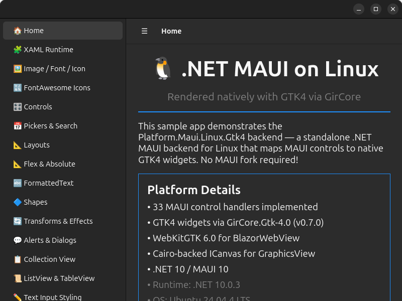<br/><b>Home & Sidebar Navigation</b></td>
<td>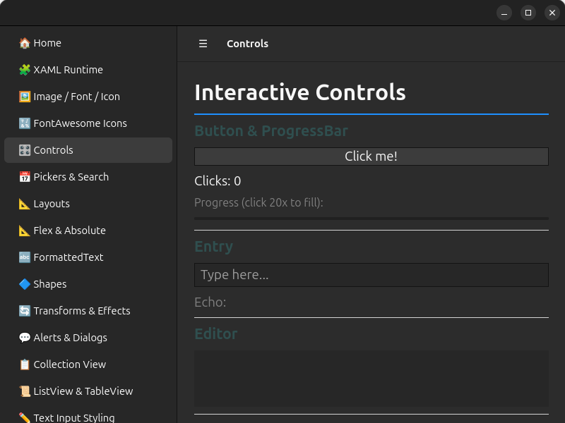<br/><b>Interactive Controls</b></td>
</tr>
<tr>
<td>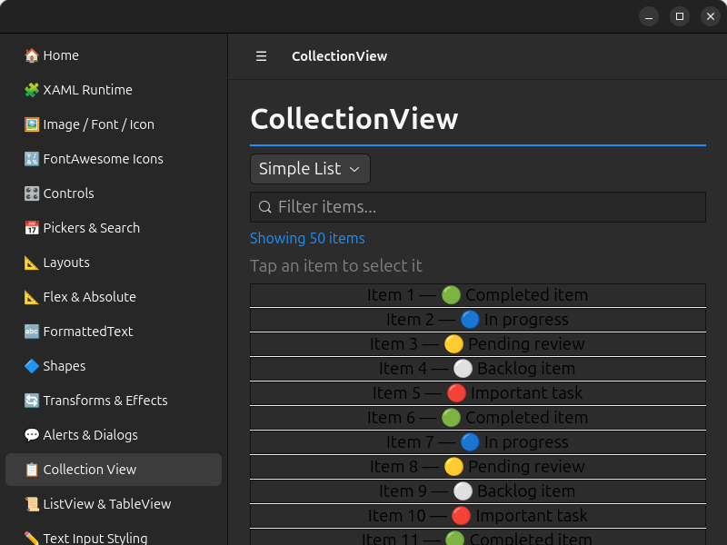<br/><b>CollectionView (Virtualized)</b></td>
<td>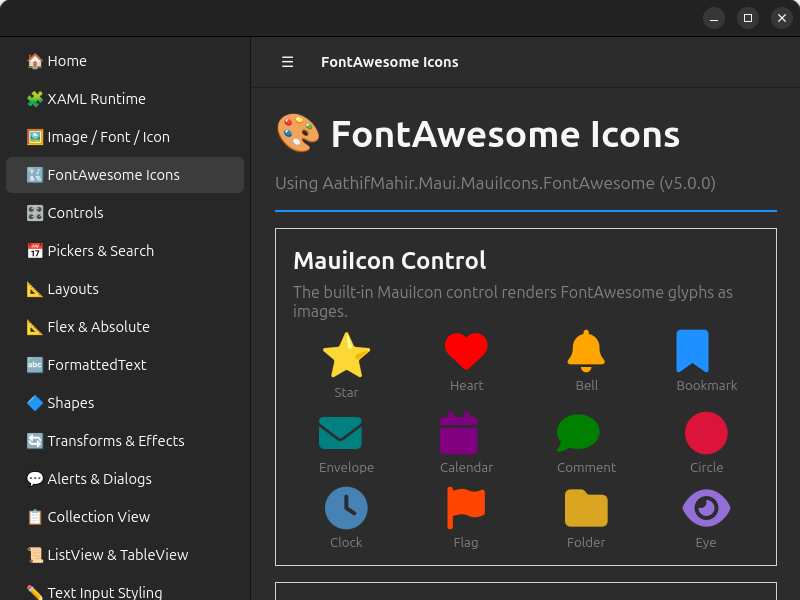<br/><b>FontAwesome Icons</b></td>
</tr>
<tr>
<td>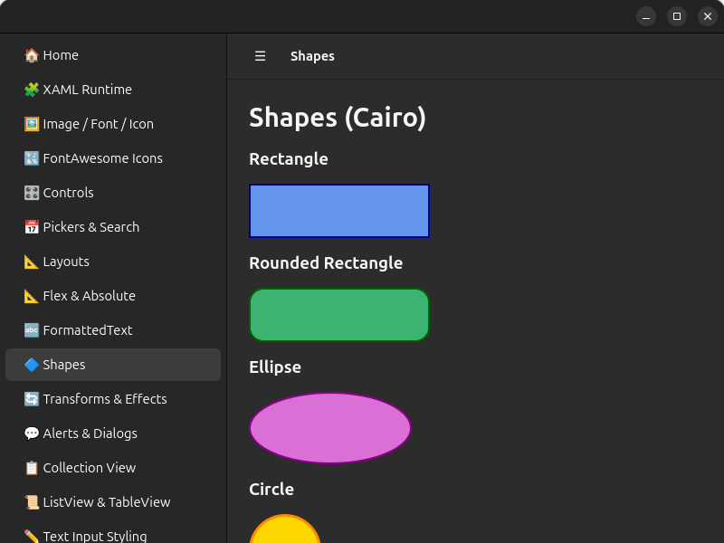<br/><b>Shapes & Graphics</b></td>
<td>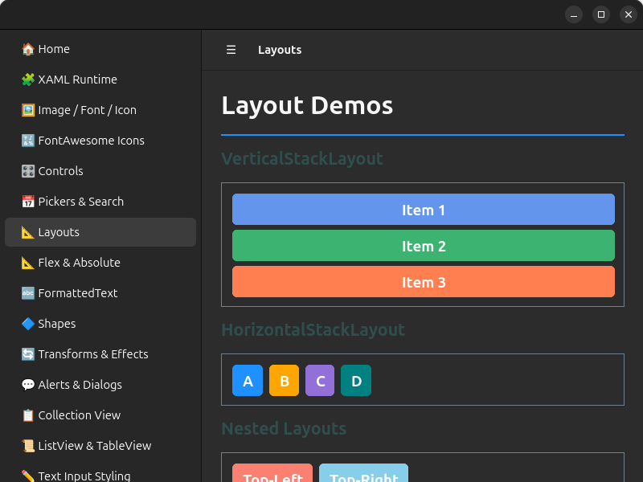<br/><b>Layouts</b></td>
</tr>
<tr>
<td>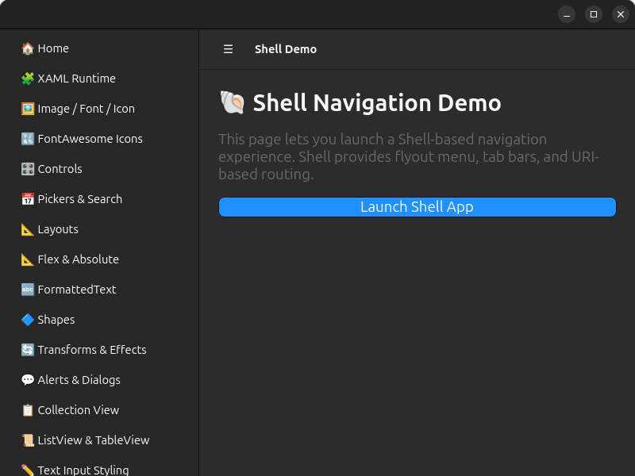<br/><b>ControlTemplate & ContentPresenter</b></td>
<td>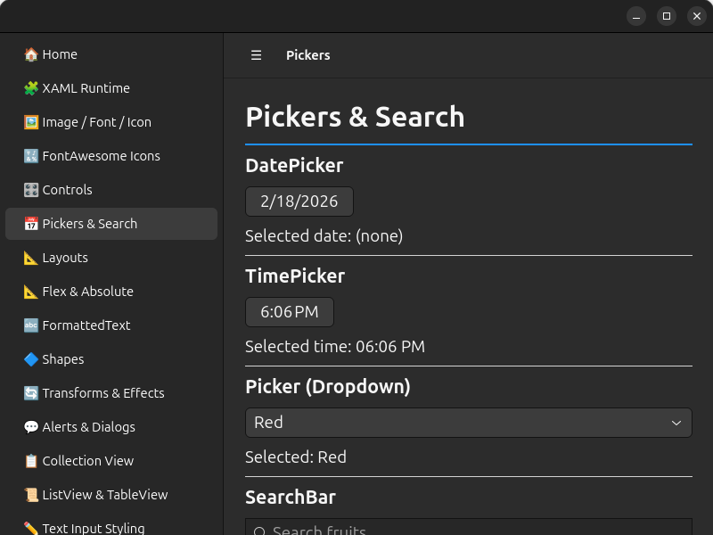<br/><b>Pickers & Search</b></td>
</tr>
<tr>
<td>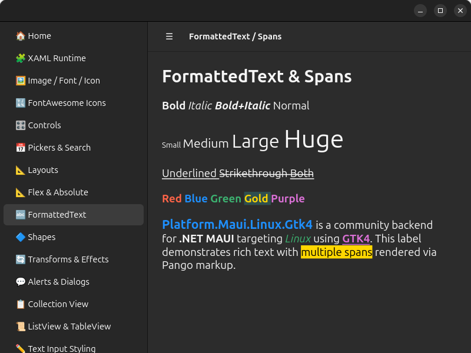<br/><b>FormattedText & Spans</b></td>
<td>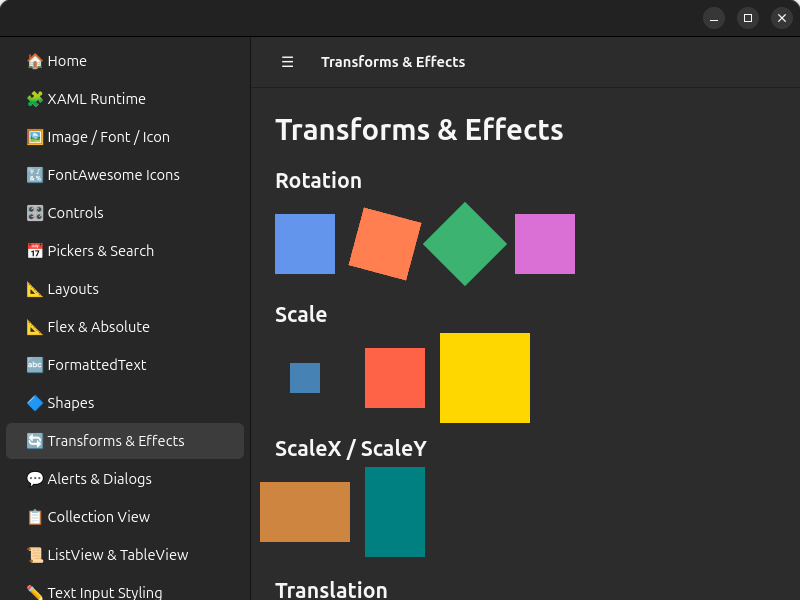<br/><b>Transforms & Effects</b></td>
</tr>
<tr>
<td colspan="2">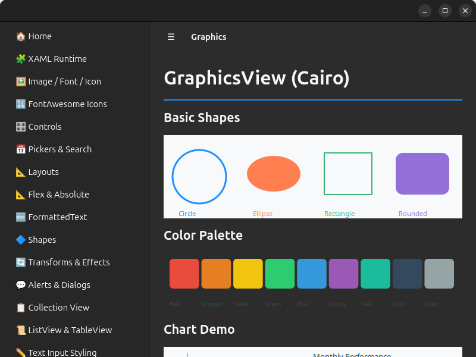<br/><b>GraphicsView (Cairo)</b></td>
</tr>
</table>

## Features

### Controls and handlers

| Category | Controls |
|----------|----------|
| **Basic Controls** | Label, Button, Entry, Editor, CheckBox, Switch, Slider, Stepper, ProgressBar, ActivityIndicator, Image, ImageButton, BoxView, RadioButton |
| **Input & Selection** | Picker, DatePicker, TimePicker, SearchBar |
| **Collections** | CollectionView (virtualized `Gtk.ListView`), ListView, TableView, CarouselView, SwipeView, RefreshView, IndicatorView |
| **Layouts** | StackLayout, Grid, FlexLayout, AbsoluteLayout, ScrollView, ContentView, Border, Frame |
| **Pages & Navigation** | ContentPage, NavigationPage, TabbedPage, FlyoutPage, Shell (flyout, tabs, route navigation) |
| **Shapes** | Rectangle, Ellipse, Line, Path, Polygon, Polyline — Cairo-rendered with fill, stroke, dash patterns |
| **Other** | GraphicsView (Cairo), WebView (WebKitGTK) |

> **Layout architecture:** StackLayout, Grid, FlexLayout, and AbsoluteLayout all share a single `LayoutHandler` — the MAUI `Layout` base class is mapped once, and all concrete layout types resolve through it.

### Platform Features

- **Native GTK4 rendering** — Every control maps to a real GTK4 widget, styled via GTK CSS.
- **UI synchronization context** — Async UI event handlers resume on the GTK main thread after `await` (unless they explicitly opt out with `ConfigureAwait(false)`).
- **Blazor Hybrid** — Host Blazor components inside a native GTK window via WebKitGTK.
- **Gestures** — Tap, Pan, Swipe, Pinch, and Pointer gesture recognizers via GTK4 event controllers, integrated through MAUI 11's public `IGesturePlatformManagerFactory`.
- **Animations** — `TranslateTo`, `FadeTo`, `ScaleTo`, `RotateTo` via `GtkPlatformTicker` + `Gsk.Transform` at ~60fps.
- **Transforms** — TranslationX/Y, Rotation, Scale via `Gsk.Transform`; Shadow (CSS `box-shadow`), Clip, ZIndex.
- **VisualStateManager** — Normal, PointerOver, Pressed, Disabled, Focused states via GTK4 event controllers.
- **ControlTemplate** — Full ContentPresenter and TemplatedView support via `IContentView` handler mapping.
- **Font icons** — Embedded fonts are registered process-locally with fontconfig/Pango (no persistent user-font copy), with FontImageSource rendering via Cairo.
- **FormattedText** — Rich text via Pango markup: Span colors, fonts, sizes, bold/italic, underline/strikethrough, character spacing.
- **Alerts & Dialogs** — `DisplayAlert`, `DisplayActionSheet`, `DisplayPromptAsync` via native GTK4 modal windows and MAUI 11's public typed `IAlertManagerSubscription` contract.
- **Modal Pages** — `PushModalAsync` presents pages as native GTK4 dialog windows by default, with attached properties for custom sizing, content-fit sizing, and inline (legacy) presentation via `GtkPage`.
- **Brushes & Gradients** — SolidColorBrush, LinearGradientBrush, RadialGradientBrush via CSS gradients.
- **MenuBar** — `MenuBarItem` / `MenuFlyoutItem` via `Gtk.PopoverMenuBar`, integrated into Window and NavigationPage handlers via `GtkMenuBarManager` (not a standalone handler).
- **Tooltips & Context Menus** — `ToolTipProperties.Text` and `ContextFlyout` via `Gtk.PopoverMenu`.
- **Theming** — Automatic light/dark theme detection via `GtkThemeManager`.
- **Lifecycle Events** — `ConfigureLifecycleEvents().AddGtk()` hooks for `OnWindowCreated` and `OnMauiApplicationCreated`.
- **Desktop integration** — App icons via hicolor icon theme, `.desktop` file generation, `MauiImage`/`MauiFont`/`MauiAsset` resource processing.

### Window sizing

Windows default to 1024 x 768 when the app does not specify a size. Set `Window.Width`
and `Window.Height` to request another initial or runtime size, and `Window.MinimumWidth`
and `Window.MinimumHeight` to impose application-specific lower bounds. GTK's native
content minimums still apply; there is no backend-imposed 800 x 600 minimum.
Root MAUI layouts reflow using their actual GTK allocation, including space reserved
by native containers and window chrome.

`Window.Width`/`Height` report the allocated client area (excluding a native titlebar),
and `Window.SizeChanged` follows actual allocation changes, not just size requests.
Pages, including `NavigationPage` and `Shell`, report their own native allocation;
the current content page excludes navigation chrome. Their `SizeChanged` and
`OnSizeAllocated` callbacks and top-level layout frames can be used for responsive UI.
Vertical `CollectionView` templates reflow at their allocated row width.

The existing native sizing host covers initial sizing, minimum sizes, nested
layouts, scrolling, NavigationPage/Shell frames and events, independent windows,
unchanged allocations, decorated client areas, handler reconnect, and collection
cards. It runs in the normal GTK CI runtime matrix. To run the same checks on Linux:

```bash
RUN_GTK_RUNTIME_TESTS=1 GDK_BACKEND=x11 GSK_RENDERER=cairo GTK_A11Y=none \
  dbus-run-session -- xvfb-run --auto-servernum \
  dotnet test platforms/Linux.Gtk4/tests/Linux.Gtk4.Tests/Linux.Gtk4.Tests.csproj \
  --configuration Release --filter FullyQualifiedName~WindowSizingTests \
  --logger "console;verbosity=detailed"
```

### Shell navigation regression checks

Shell section navigation displays the top pushed page and restores the previous
page when popped, including route navigation, `PushAsync`, and `PopToRootAsync`.
Managed observer tests run with the normal GTK test project. The native regression
test additionally checks the selected notebook child, its mapped state, and a
positive GTK allocation in a real window. Run it on Linux with GTK and Xvfb:

```bash
MAUI_GTK_RUNTIME_TESTS=1 GDK_BACKEND=x11 GSK_RENDERER=cairo xvfb-run -a \
  dotnet test platforms/Linux.Gtk4/tests/Linux.Gtk4.Tests/Linux.Gtk4.Tests.csproj \
  --filter FullyQualifiedName~ShellNavigationRuntimeTests \
  --logger "console;verbosity=detailed"
```

The test uses its own GTK application and does not require a DevFlow broker.

### Handler styling

`ContentViewHandler` now hosts its content in `GtkLayoutPanel`, so child translation,
scale, rotation, anchors, and MAUI-arranged offsets use the same native allocation
path as layout children. `LayoutHandler` also preserves transforms across arrange
passes. `ContentView.IsClippedToBounds` clips translated content to its viewport;
clearing a separate `Clip` does not disable bounds clipping. ContentView and layout
roots share an allocation-driven layout helper. For direct ScrollView content it
uses the native viewport on non-scrolling axes and measures scrolling axes without
a bound, preserving scroll extent while allowing the viewport to shrink.

**Breaking change:** custom handlers compiled against the previous
`Gtk.Box` platform-view type must be rebuilt and use `GtkLayoutPanel` child APIs
(`AddChild` / `RemoveChild`, not `Append` / `Remove`).

The native regression runs on Linux with GTK 4.12+ and an isolated display:

```bash
RUN_GTK_RUNTIME_TESTS=1 GDK_BACKEND=x11 GSK_RENDERER=cairo \
  dbus-run-session -- xvfb-run -a dotnet test \
  platforms/Linux.Gtk4/tests/Linux.Gtk4.Tests/Linux.Gtk4.Tests.csproj \
  --filter FullyQualifiedName~ContentViewTransformTests
```

The ordinary managed test run skips native tests unless explicitly enabled.
Run each native test class in a separate process to keep GTK thread ownership isolated.
`ContentViewClippingTests` checks rendered header and content pixels and writes PNG
evidence when `GTK_TEST_ARTIFACTS` is set. `ContentViewRootLayoutTests` covers
ContentView/Border nesting and all ScrollView orientations; `GtkRootLayoutDriverTests`
checks root ownership, reparenting, callback disposal, and logged layout failures.

GTK CSS font sizes use logical pixels (`px`), matching MAUI's device-independent
font sizes. Handler CSS is composed per widget, selector, and mapper, so font,
color, spacing, background, and border updates preserve one another. Custom
handlers should pass a complete fragment to `UpdateCss` / `UpdateCssWithSelector`
on every update, including null or empty CSS to remove that fragment's overrides.
The optional `property` key defaults to the calling method's name; shared helpers
must supply distinct keys for independently updated properties. For overlapping
declarations of equal specificity, the most recently updated fragment wins.
The original `ApplyCss` / `ApplyCssWithSelector` signatures remain available for
compiled custom handlers and share a legacy fragment per widget and selector.

### Transform point ownership

`Graphene.Point.Alloc()` returns a point owned by a GirCore `SafeHandle`.
Do not call its native `Free()` method after passing it to `Gsk.Transform.Translate`:
the handle still owns the allocation and will free it again during finalization.
This applies to layout-position points as well as anchor points.

### Essentials

| Status | Services |
|--------|----------|
| ✅ **Done** | AppInfo, AppActions, Battery (UPower), Browser (`xdg-open`), Clipboard (`Gdk.Clipboard`), Connectivity (NetworkManager), DeviceDisplay, DeviceInfo, Email (`xdg-open mailto:`), FilePicker (`Gtk.FileDialog`), FileSystem (XDG dirs), Launcher, Map, MediaPicker selection and GStreamer photo/video capture, Preferences (JSON), Screenshot, SecretStorage (Secret Service), SemanticScreenReader (`Gtk.Accessible`), Share (XDG Portal), TextToSpeech (`speech-dispatcher`/`espeak`), VersionTracking |
| ⚠️ **Partial** | Geolocation (GeoClue `where-am-i` one-shot and foreground polling; no long-lived D-Bus subscription), WebAuthenticator (basic OAuth via system browser) |
| ❌ **Stub** (13) | Accelerometer, Barometer, Compass, Contacts, Flashlight, Geocoding, Gyroscope, HapticFeedback, Magnetometer, OrientationSensor, PhoneDialer, SMS, Vibration — sensors and phone-specific APIs not applicable to desktop Linux |

Linux SecureStorage uses libsecret's `secret-tool` client and an unlocked
freedesktop.org Secret Service provider. Values are passed over standard input,
not command-line arguments, and this backend never falls back to plaintext files.
A missing `secret-tool` throws `FeatureNotSupportedException`; locked or unavailable
providers return an explicit operation error. Install the distribution's libsecret
tools package and configure a provider such as GNOME Keyring or KWallet.

Linux camera capture requires `gst-launch-1.0`, `gst-inspect-1.0`, and the
GStreamer `v4l2src`, `videoconvert`, `jpegenc`, `vp8enc`, and `webmmux`
plugins. Photo capture writes JPEG and video capture writes VP8/WebM. The native
capture window supports cancellation and graceful video Stop; partial files are
deleted after cancellation, failure, empty output, or finalization timeout.
Capture selects an actual `/dev/video*` V4L2 device and never uses
`autovideosrc`, because that element can silently substitute `videotestsrc`
when no camera is available. Portal-only cameras without a V4L2 device are
therefore reported as unsupported. Missing tools/plugins, absent devices,
permission failures, and pipeline failures are explicit rather than an empty or
synthetic successful result.

#### Use your own ISecureStorage implementation

An app can supply its own `Microsoft.Maui.Storage.ISecureStorage` implementation.
In the Linux app's `MauiProgram.cs`, register it before calling
`AddLinuxGtk4Essentials()` and before `builder.Build()`:

```csharp
using Microsoft.Extensions.DependencyInjection;
using Microsoft.Maui.Platforms.Linux.Gtk4.Essentials.Hosting;
using Microsoft.Maui.Storage;

// MySecureStorage is an ISecureStorage implementation supplied by your app.
builder.Services.AddSingleton<ISecureStorage, MySecureStorage>();
builder.AddLinuxGtk4Essentials();
```

`AddLinuxGtk4Essentials()` keeps an existing `ISecureStorage` registration.
When the app is built, it also sets `SecureStorage.Default` to that service.
Both injected `ISecureStorage` instances and calls such as
`SecureStorage.GetAsync("api_token")` then use your implementation.

Your implementation must provide `GetAsync`, `SetAsync`, `Remove`, and `RemoveAll`,
and use a suitable secure storage service. Do not store secrets in plain text or
store an encryption key beside the encrypted data.

### Implementation Parity

| Category | Coverage | Notes |
|----------|----------|-------|
| Core Infrastructure | 100% | Dispatcher, handler factory, rendering pipeline |
| Pages | 100% | ContentPage, NavigationPage, TabbedPage, FlyoutPage, Shell |
| Layouts | 100% | All layout types including FlexLayout and AbsoluteLayout |
| Basic Controls | 100% | All 14 standard controls |
| Input Controls | 100% | Picker, DatePicker, TimePicker, SearchBar |
| Collection Controls | 100% | Virtualized CollectionView with logical parenting of realized template views, ListView, TableView, CarouselView, SwipeView |
| Navigation & Routing | 100% | Push/pop, Shell routes, query parameters |
| Alerts & Dialogs | 100% | All three dialog types + native modal dialog windows |
| Gesture Recognizers | 100% | All 5 gesture types |
| Graphics & Shapes | 100% | GraphicsView + all 6 shape types |
| Font Management | 100% | Registrar, manager, FontImageSource, named sizes |
| WebView | 100% | URL, HTML, JavaScript, navigation events |
| Animations | 100% | All animation types via GtkPlatformTicker |
| VisualStateManager | 100% | All visual states + triggers + behaviors |
| ControlTemplate | 100% | ContentPresenter, TemplatedView |
| Base View Properties | 100% | Opacity, visibility, transforms, shadow, clip, automation |
| FormattedText | 100% | All Span properties via Pango markup |
| MenuBar | 100% | MenuBarItem, MenuFlyoutItem, popover menus — integrated into Window and NavigationPage handlers |
| Essentials | Partial desktop coverage | Secure storage, media selection/capture, speech, battery, accessibility and desktop integration are implemented; location uses foreground GeoClue polling, while sensors and phone APIs remain limited or unsupported. |

## Prerequisites

| Requirement | Version |
|---|---|
| .NET SDK | 11.0.100-rc.2.26504.105 or newer .NET 11 build |
| GTK 4 libraries | 4.12+ (system package) |
| WebKitGTK *(Blazor only)* | 6.x (system package) |
| GStreamer *(camera capture only)* | 1.0 command-line tools plus base/good plugins |

The templates and default documentation target `net11.0`. The shipping platform,
Essentials, BlazorWebView, and test projects retain `net10.0` assets for the
intentional MAUI 10 compatibility lane. A .NET 11 SDK can build both targets.
Private/reflection compatibility shims are compiled only into the `net10.0`
assets; the `net11.0` assets use public MAUI contracts exclusively.

### Install GTK4 & WebKitGTK (Debian / Ubuntu)

```bash
sudo apt install libgtk-4-dev libwebkitgtk-6.0-dev \
  gobject-introspection libgirepository1.0-dev \
  gir1.2-gtk-4.0 gir1.2-webkit-6.0 pkg-config
```

### Install GTK4 & WebKitGTK (Fedora)

> **Note:** Fedora package names below are unverified. Please open an issue if they need correction.

```bash
sudo dnf install gtk4-devel webkitgtk6.0-devel \
  gobject-introspection-devel pkg-config
```

> On Fedora versions where these package names apply, `gtk4-devel` and `webkitgtk6.0-devel` typically include the GObject Introspection typelibs, so separate `gir1.2-*` packages are usually not needed.

## Quick Start

### Option 1: Use the template (recommended)

```bash
# Install the template
dotnet new install Microsoft.Maui.Platforms.Linux.Gtk4.Templates --prerelease

# Create a new Linux MAUI app
dotnet new maui-linux-gtk4 -n MyApp.Linux
cd MyApp.Linux
dotnet run
```

The packaged template pins its GTK4 package references to the package version produced
by the same build. Essentials is enabled by default: the generated `MauiProgram.cs`
calls `AddLinuxGtk4Essentials()` to register Linux services and static API defaults,
including `SemanticScreenReader`. Use `--essentials false` to omit both the package
and registration, or `--blazor true` to include the BlazorWebView package and its
`AddMauiBlazorWebView().UsePlatformHandler<BlazorWebViewHandler>()` registration.

### Option 2: Add to an existing project manually

Add the NuGet package:

```bash
dotnet add package Microsoft.Maui.Platforms.Linux.Gtk4 --prerelease
dotnet add package Microsoft.Maui.Platforms.Linux.Gtk4.Essentials --prerelease   # optional
```

Then set up your entry point:

**Program.cs**

```csharp
using Microsoft.Maui.Platforms.Linux.Gtk4.Platform;
using Microsoft.Maui.Hosting;

public class Program : GtkMauiApplication
{
    protected override MauiApp CreateMauiApp() => MauiProgram.CreateMauiApp();

    public static void Main(string[] args)
    {
        var app = new Program();
        app.Run(args);
    }
}
```

**MauiProgram.cs**

```csharp
using Microsoft.Maui.Platforms.Linux.Gtk4.Hosting;
using Microsoft.Maui.Hosting;

public static class MauiProgram
{
    public static MauiApp CreateMauiApp()
    {
        var builder = MauiApp
            .CreateBuilder()
            .UseMauiAppLinuxGtk4<App>();

        return builder.Build();
    }
}
```

If you added the optional Essentials package, also import
`Microsoft.Maui.Platforms.Linux.Gtk4.Essentials.Hosting` and call
`builder.AddLinuxGtk4Essentials()` before `builder.Build()`. Adding the package
alone does not replace MAUI's portable Essentials implementations.

When `Build()` returns, all registered static Essentials facades use the same
instances as dependency injection, including application overrides registered
before or after `AddLinuxGtk4Essentials()`. Call statics after `Build()`, not while
configuring the builder. Unsupported desktop capabilities retain their existing
stub behavior. Facades are process-wide: the most recently built app sets their
instances, and callers must not use them after disposing that app.

The `net11.0` GTK package only registers services in DI. MAUI 11's built-in
Essentials DI bridge connects those services to the static facades during
`Build()`; that asset does not link or invoke MAUI's private initializer
implementation. The linked compatibility initializer remains isolated to the
`net10.0` asset because MAUI 10 has no public equivalent.

`DeviceInfo.Platform` reports `DevicePlatform.Create("GTK")`. On MAUI 11,
screenshot support implements both `IScreenshot` and `IViewScreenshot`;
whole-window failures throw instead of returning a null value, while view capture
returns null only when the supplied platform object is not a GTK widget. PNG
results are reusable. The MAUI 10 asset retains `IScreenshot`.

`FileSystem.AppDataDirectory` and `CacheDirectory` use `XDG_DATA_HOME` and
`XDG_CACHE_HOME`, falling back to `~/.local/share` and `~/.cache`, respectively,
with the application name appended. Both getters create the directory before
returning it, preserve existing contents, and propagate filesystem errors.
Paths are resolved on every access, including changes to the XDG variables.

Run the registration and filesystem regressions on Linux:
`dotnet test platforms/Linux.Gtk4/tests/Essentials.Tests/Linux.Gtk4.Essentials.Tests.csproj`.
The filesystem tests cover XDG overrides and fallback paths with unique
application identities and real file writes; only their owned directories are
removed. These tests do not require a display.
Set `ESSENTIALS_NATIVE_GTK=1` under a real display (or `xvfb-run`) to also run the
GTK application activation/display regression; otherwise that test is explicitly skipped.

## XAML Support

`Microsoft.Maui.Platforms.Linux.Gtk4` relies on MAUI's normal transitive build assets for XAML.
In Linux head projects, `*.xaml` files are still collected as `MauiXaml` and compiled by MAUI's XAML build pipeline without extra package-specific overrides.

## Resource Item Support

Linux head projects can use MAUI resource item groups for common `Resources/*` paths:

- `MauiImage` from `Resources/Images/**`
- `MauiFont` from `Resources/Fonts/**`
- `MauiAsset` from `Resources/Raw/**` (with `LogicalName` defaulting to `%(RecursiveDir)%(Filename)%(Extension)`)
- `MauiIcon` from explicit items, or default `Resources/AppIcon/appicon.{svg|png|ico}`

The `net11.0` asset opts into MAUI 11's Resizetizer with
`ResizetizerPlatformType=linux`, selects the neutral-TFM backend with
`MauiActiveBackend=linux`, and consumes the public `MauiProcessedImage`,
`MauiProcessedFont`, and `MauiProcessedAsset` outputs. Processed target paths are
preserved, including `MauiAsset` logical names under `Resources/Raw`. `MauiIcon`
continues to emit the Linux `hicolor` icon-theme layout, and runtime sets the GTK
window default icon name from that icon.

`Platforms/Linux/**` is registered through the public
`MauiPlatformSpecificFolder`/`BackendIdentity` contract, so a Linux head can keep
platform-only source and resources in that folder without affecting other heads.
The `net10.0` asset retains the established raw-copy resource path because MAUI 10
does not publish these external-backend processed-item contracts.

The package-only consumer fixture exercises .NET 10 and .NET 11 referenced-library raw assets,
logical names (including Unicode and empty files), incremental changes and
removal, no-build publish, and collision failures:

```powershell
./eng/smoke-tests/community-resource-acceptance.ps1 -Backend gtk
```

GTK is the harness default while the community backend migration is being
landed in layers. Its explicit AppKit, WPF, and backend-switch modes are reserved
for their later platform layers; GTK CI does not invoke them.

## Adding Linux to a Multi-Targeted MAUI App

Since there is no official `-linux` TFM (Target Framework Moniker) from Microsoft, MAUI projects can't conditionally include the Linux backend via `TargetFrameworks` the way they do for Android/iOS/Windows. Instead, use the **"Linux head project"** pattern:

```
MyApp/                              ← Your existing multi-targeted MAUI project
├── MyApp.csproj                       (net11.0-android;net11.0-ios;...)
├── App.cs
├── MainPage.xaml
├── ViewModels/
├── Services/
└── Platforms/
    ├── Android/
    ├── iOS/
    └── ...

MyApp.Linux/                        ← New Linux-specific project
├── MyApp.Linux.csproj                 (net11.0, references Microsoft.Maui.Platforms.Linux.Gtk4)
├── Program.cs                         (GtkMauiApplication entry point)
└── MauiProgram.cs                     (builder.UseMauiAppLinuxGtk4<App>())
```

### Setup

1. **Create the Linux head project** next to your MAUI project:

```bash
dotnet new maui-linux-gtk4 -n MyApp.Linux
```

2. **Reference your shared code** — add a project reference from `MyApp.Linux.csproj` to your MAUI project (or a shared class library):

```xml
<!-- MyApp.Linux.csproj -->
<ItemGroup>
  <ProjectReference Include="../MyApp/MyApp.csproj" />
</ItemGroup>
```

3. **Run on Linux:**

```bash
dotnet run --project MyApp.Linux
```

### Why a separate project?

The platform-specific TFMs (`net11.0-android`, `net11.0-ios`, etc.) are powered by .NET workloads that Microsoft ships. Creating a custom `net11.0-linux` TFM would require building and distributing a full .NET workload — complex infrastructure that's unnecessary for most use cases.

The separate project approach works with standard `dotnet build`/`dotnet run`, is NuGet-distributable, and keeps your existing MAUI project unchanged.

## DevFlow Integration

The GTK4 backend supports [DevFlow](../../src/DevFlow/) for AI-assisted UI inspection, automation, and debugging, including the Blazor CDP bridge. To enable it, set `EnableMauiDevFlow=true` in `Directory.Build.props` (or pass it as an MSBuild property):

```xml
<!-- Directory.Build.props -->
<PropertyGroup>
  <EnableMauiDevFlow>true</EnableMauiDevFlow>
</PropertyGroup>
```

When enabled, the sample project (`samples/Linux.Gtk4.Sample`) conditionally references the DevFlow agent and Blazor projects:

```xml
<ItemGroup Condition="'$(EnableMauiDevFlow)' == 'true'">
  <ProjectReference Include="..\..\..\..\src\DevFlow\Microsoft.Maui.DevFlow.Agent.Gtk\Microsoft.Maui.DevFlow.Agent.Gtk.csproj" />
  <ProjectReference Include="..\..\..\..\src\DevFlow\Microsoft.Maui.DevFlow.Blazor.Gtk\Microsoft.Maui.DevFlow.Blazor.Gtk.csproj" />
</ItemGroup>
```

## Building from Source

From the repository root, run the template regression checks with PowerShell 7:

```powershell
pwsh -File eng/smoke-tests/gtk-template-smoke-test.ps1 -BuildApps
```

This packs the templates with default and overridden package versions, generates
the default app and all Essentials/Blazor option combinations in isolated template
hives, and checks their references and registration. `-BuildApps` also packs the
backend packages, restores/builds the default-version apps, and checks the
`SemanticScreenReader` DI and static defaults without loading native GTK.
Omit `-BuildApps` for template-only checks. GTK window rendering and speech output
still require Linux runtime validation.

```bash
git clone https://github.com/dotnet/maui-labs.git
cd maui-labs/platforms/Linux.Gtk4
dotnet restore
dotnet build
```

### Managed regression tests

The CSS composition and font CSS tests do not require GTK native libraries or a display.
From `platforms/Linux.Gtk4`, run:

```bash
dotnet test tests/Linux.Gtk4.Tests/Linux.Gtk4.Tests.csproj
```

The Linux GTK4 CI build uses .NET 11 and runs the managed registration, public
build-contract, handler-selection, and Essentials DI-bridge tests. These checks
do not require GTK initialization and do not claim native UI coverage.

### Native regression tests in the shared test host

Native tests live alongside managed tests in `Linux.Gtk4.Tests`, use
`[GtkRuntimeFact]` and the `GTK runtime` collection, and opt in with
`RUN_GTK_RUNTIME_TESTS=1` on Linux. Normal portable test runs skip these cases;
those skips are not native validation. Run each native class in a separate
process because GTK initialization is thread-affine.

The CollectionView tests require Linux, GTK 4.12 or newer, and a display. They exercise the real
GTK list-item factory, including logical parenting, DevFlow tree discovery,
source replacement, runtime item/group-header template replacement, group headers,
and recursive handler disconnection of retired roots and nested template children.
Cleanup is checked after source replacement, template rebuild, and handler teardown,
including repeated cleanup without duplicate disconnection. Template changes do not
require an ItemsSource change. The suite also covers signal cleanup during factory
and visual-state controller replacement.

`GtkBlazorWebViewLifetimeTests` requires WebKitGTK 6.0 and covers script-message
handler cleanup on disposal.

`GtkSignalLifetimeTests` repeatedly connects real MAUI button and layout handlers,
forces collection, emits native clicks, and verifies that click and visual-state
controller signals are disconnected before retiring their owners. It pumps GTK
during finalization to exercise closure/native teardown lifetime boundaries.

`ContentViewRootLayoutTests` covers child-size changes without window resizing,
measure invalidation and idle layout convergence.

`StartupLayoutTests` starts the first window with a Shell root page containing a
ScrollView, stacked heading, initially hidden button row, and CollectionView.
It checks managed and native allocations when background-loaded cards arrive and
the hidden content becomes visible, without navigation or window resizing, then
expands the collection viewport to check both realized cards.

The Picker regression checks item replacement, no selection, collection
mutations, managed selection mapping, native selection notifications, and
disconnect/reconnect behavior.

The synchronization-context regression starts a real `GtkMauiApplication`,
invokes an async MAUI button handler from the GTK main loop, and checks thread
identity, context preservation across repeated awaits, native label updates,
and restoration of the original context after shutdown.

From the repository root on Linux, use the shared class runner (PowerShell 7,
`dbus-run-session`, and `xvfb-run` are required):

```bash
pwsh -File platforms/Linux.Gtk4/tests/run-native-tests.ps1 -TestClass CollectionViewHandlerTests
pwsh -File platforms/Linux.Gtk4/tests/run-native-tests.ps1 -TestClass GtkBlazorWebViewLifetimeTests
pwsh -File platforms/Linux.Gtk4/tests/run-native-tests.ps1 -TestClass GtkSignalLifetimeTests
pwsh -File platforms/Linux.Gtk4/tests/run-native-tests.ps1 -TestClass PickerSelectionTests
pwsh -File platforms/Linux.Gtk4/tests/run-native-tests.ps1 -TestClass GtkSynchronizationContextTests
pwsh -File platforms/Linux.Gtk4/tests/run-native-tests.ps1 -TestClass ContentViewRootLayoutTests
pwsh -File platforms/Linux.Gtk4/tests/run-native-tests.ps1 -TestClass StartupLayoutTests
pwsh -File platforms/Linux.Gtk4/tests/run-native-tests.ps1 -TestClass GtkTransformTests
```

The runner requires a .NET 11 SDK, creates a private DBus session and display, requires nonzero executed
tests with no failures or skips in the TRX, and rejects missing/empty filtered
classes. Use a fresh `-ResultsDirectory` when repeating a run to preserve prior
evidence. Use `-TestProject` and `-TestNamespace` to select tests in another project.
CI's `runtime` matrix runs one existing native class per process; retain
the union of native class entries when integrating other platform changes.

The transform regression creates a real GTK window and repeatedly scales and
rotates a button at origin, off-origin, translated, and translation-cancelled
positions. Forced finalization detects native point double frees; coordinate
assertions check that transforms still work.

The native CI job runs each test class in a separate process to keep GTK
initialization on one thread and uploads its TRX results.

### Run the sample app

```bash
# Sample app (includes native controls, Blazor Hybrid, essentials, and more)
dotnet run --project samples/Linux.Gtk4.Sample
```

For a focused DevFlow check, set `MAUI_SAMPLE_COLLECTIONVIEW=1` when launching
the sample with `-p:EnableMauiDevFlow=true`. Choose **CollectionView** in its
example picker. Realized contact labels are discoverable by text and by their
name as an automation id. Tapping **Alice Johnson** or **Bob Smith** updates the
status to `Tapped: <name>`. Unrealized rows are not logical children until GTK
realizes them.

The native CI job also builds the DevFlow-enabled sample and runs
`tests/devflow_collectionview_smoke.py` under dbus/Xvfb. It verifies the owned
process identity before mutation and asserts both command outcomes, then uploads
the application log, query/tap JSON, tree and screenshot as
`gtk-collectionview-devflow-evidence`.

## Project Structure

```
Linux.Gtk4.slnx                                            # Platform-local solution file
├── src/
│   ├── Linux.Gtk4/                                         # Core MAUI backend
│   │   ├── Handlers/                     # GTK4 handler implementations
│   │   ├── Hosting/                      # AppHostBuilderExtensions (UseMauiAppLinuxGtk4)
│   │   └── Platform/                     # GTK application, context, layout, theming
│   ├── Linux.Gtk4.Essentials/                             # MAUI Essentials for Linux (clipboard, etc.)
│   └── Linux.Gtk4.BlazorWebView/                          # BlazorWebView support via WebKitGTK
├── samples/
│   └── Linux.Gtk4.Sample/                                 # Sample app (controls, Blazor, essentials)
├── templates/                            # dotnet new templates
└── docs/                                 # Documentation
```

## NuGet Packages

| Package | Purpose |
|---|---|
| `Microsoft.Maui.Platforms.Linux.Gtk4` | Core GTK4 backend — handlers, hosting, platform services |
| `Microsoft.Maui.Platforms.Linux.Gtk4.Essentials` | MAUI Essentials (clipboard, preferences, device info, etc.) |
| `Microsoft.Maui.Platforms.Linux.Gtk4.BlazorWebView` | Blazor Hybrid support via WebKitGTK |
| `Microsoft.Maui.Platforms.Linux.Gtk4.Templates` | `dotnet new` project templates |

## Key Dependencies

| Package | Purpose |
|---|---|
| `GirCore.Gtk-4.0` | GObject introspection bindings for GTK4 |
| `GirCore.WebKit-6.0` | WebKitGTK bindings (Blazor support) |
| `Microsoft.Maui.Controls` | .NET MAUI framework |
| `Tmds.DBus.Protocol` | D-Bus client for Linux platform services |

## License

This project is licensed under the [MIT License](LICENSE).
